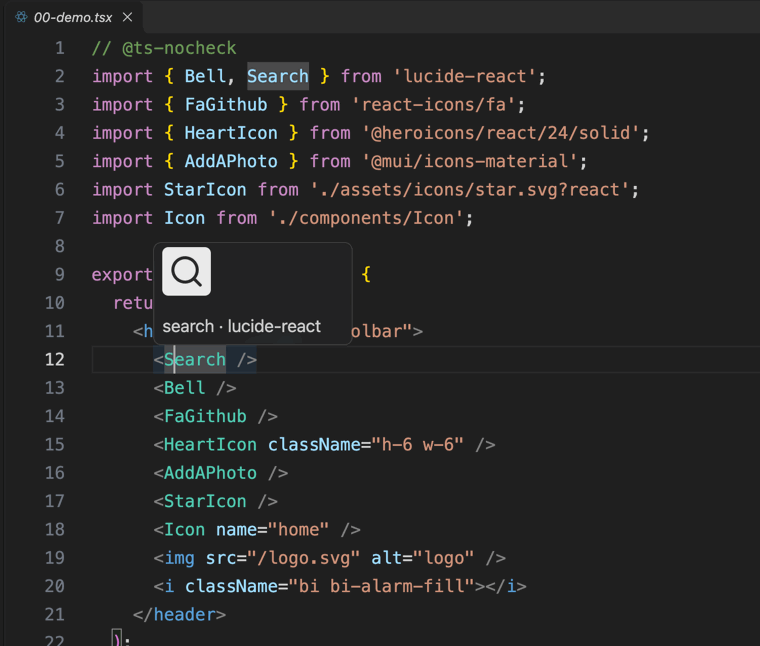
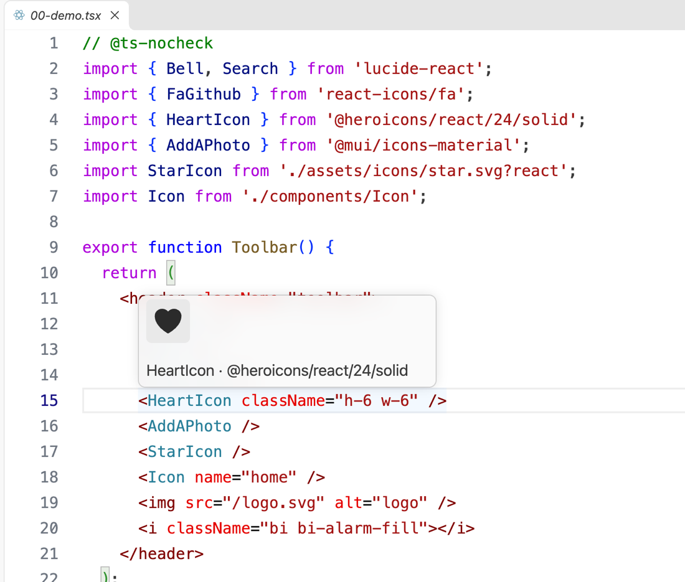

<p align="center">
  
</p>

<h1 align="center">IconPeek</h1>

<p align="center">
  <b>See the icon, not its name.</b><br>
  Hover an icon in your code and the rendered glyph pops up. No opening the SVG, no running the app.
</p>

<p align="center">
  
</p>

## Features

- **Works on what you already write:** `<SearchIcon />`, `<Icon name="search" />`, `` tags pointing at an SVG, `<use href="sprite.svg#id">`, inline `<svg>`, `<i class="fa-solid fa-house">`.
- **Reads your real icon sources:** local `.svg` files, `lucide-react`, `react-icons`, `@heroicons/react`, `@mui/icons-material`, Font Awesome, Bootstrap Icons, Material Icons and the `@expo/vector-icons` / `react-native-vector-icons` sets.
- **Understands your own `<Icon name="…" />`:** follows the import (including `@/` aliases from `tsconfig.json`) to the component and finds the name-to-icon mapping (object map, `switch`, a folder of SVGs, or a `.ttf` icon font). A setting covers the rest.
- **Never lies:** if an icon can't be resolved with confidence there is no hover at all. No placeholders, no wrong icons.
- **Safe:** static parsing only. Nothing from your workspace or `node_modules` is ever executed, and every SVG is sanitized first.
- **Readable on any theme:** the icon is drawn on a neutral chip with a fixed dark color.
- **Fast and lazy:** results are cached per file and mtime, and the extension only activates for the languages below.

<p align="center">
  
</p>

Languages: `typescriptreact`, `javascriptreact`, `html`, `vue`, `svelte`, `astro` (Vue, Svelte and Astro need their language extensions installed).

## Install

Install **IconPeek** from the Extensions view (`Ctrl+Shift+X` / `Cmd+Shift+X`), or from the command line:

```bash
code --install-extension felipelourenco.icon-peek
```

Then open any file in a supported language and hover an icon tag. There is nothing to configure for the common cases.

## Supported sources

| Source | What is resolved |
| --- | --- |
| Local SVG files | `import X from './x.svg'` (also `?react`, `?url`, `?component`, `{ ReactComponent as X }`) used as `<X />`; `` tags whose `src` is an SVG path or an imported URL; `<use href="sprite.svg#id">`. Paths resolve relative to the file, then the workspace root, then `public/`. |
| `lucide-react` | Named, aliased (`House as Home`) and namespace (`<Lucide.Star />`) imports. |
| `react-icons` | Per-pack subpaths (`react-icons/fa`, `/fa6`, `/fi`, …). |
| `@heroicons/react` | `…/24/outline`, `…/24/solid`, `…/20/solid`, `…/16/solid`. |
| `@mui/icons-material` | `@mui/icons-material/Search` or `{ Search } from '@mui/icons-material'`, including multi-element icons. |
| Your own `<Icon name="…" />` | An object map `name: Identifier`, `switch`/`case 'name'`, or a path template (`` `./icons/${name}.svg` ``, `'./icons/' + name + '.svg'`, `import.meta.glob('./icons/*.svg')`). Identifiers are followed to their own import, so the map can point at SVG files or any supported library. Fallback: `iconpeek.nameToFolder`. |
| Your own icon font (`.ttf`) | A component built with `createIconSet(glyphMap, 'family', font)` (for example `@expo/vector-icons`) and a name-to-character map: `cross: 'F'`, `'\ue900'`, or `0xe900`, in the component or in a `.json` file next to it. IconPeek reads the glyph outline straight from the font file and draws it. TrueType (`.ttf`) only; multi-character values (ligatures) show nothing. |
| Inline `<svg>` | Hover the `<svg …>` opening tag. Dynamic geometry or `{children}` inside means no hover. |
| Vector-icons sets | `<MaterialIcons name="add-a-photo" />`, `<FontAwesome5 name="mobile-alt" solid />`, `<Ionicons name="home" />` and the other sets from `@expo/vector-icons`, `react-native-vector-icons` or `@react-native-vector-icons/*`, including your own wrapper that forwards `name` to a single set. IconPeek reads the set's glyph map (`glyphmaps/*.json`) and draws the glyph from the `.ttf` shipped in the package. FontAwesome picks the weight like the library does. A wrapper that imports several sets or rewrites the name shows nothing. |
| Icon fonts | Font Awesome (`fa-solid fa-house`, `fas`, `far`, `fab`) and Bootstrap Icons (`bi bi-house`) via their SVG sources, and Material Icons ligatures (`<span class="material-icons">search</span>`, plus `-outlined`, `-round`, `-sharp`, `-two-tone`) via `@mui/icons-material`. Only when that package is installed in the workspace. |

Library layouts were inspected, not assumed. Verified against `lucide-react` 1.71, `react-icons` 5.7, `@heroicons/react` 2.2, `@mui/icons-material` 9.5, `@fortawesome/fontawesome-free` 7.3, `bootstrap-icons` 1.13, `@expo/vector-icons` 15.1, `react-native-vector-icons` 10.3 and `@react-native-vector-icons/*` 14. Other major versions may lay files out differently and will simply show nothing.

## Settings

| Setting | Default | Meaning |
| --- | --- | --- |
| `iconpeek.enabled` | `true` | Master switch. |
| `iconpeek.previewSize` | `48` | Preview box in px (16–256). The icon is scaled to fit, keeping its aspect ratio. |
| `iconpeek.languages` | the six above | Language ids where IconPeek runs. Reload the window after changing. |
| `iconpeek.iconComponentPatterns` | `{ "Icon": ["name", "icon"] }` | Components that take an icon name, mapped to the props that hold it. Only static strings count (`name="search"`). |
| `iconpeek.nameToFolder` | `{}` | Fallback when a component's mapping can't be read statically. Key is `Component` or `Component.prop`; value is a folder (workspace-relative or absolute) holding `<name>.svg`. |
| `iconpeek.maxSvgBytes` | `200000` | SVG files and previews larger than this are skipped. |

Example, for an `<Icon name="…">` component whose icons live in `src/assets/icons`:

```json
{
  "iconpeek.iconComponentPatterns": { "Icon": ["name"] },
  "iconpeek.nameToFolder": { "Icon": "src/assets/icons" }
}
```

## How it works

- **Static parsing.** Icon data is read out of the source text of SVG files and package files. Nothing is `require()`d, imported or evaluated, so the extension declares itself safe for untrusted workspaces.
- **Sanitized.** `<script>`, `<foreignObject>`, `on*` handlers, external `href` / `url()`, `javascript:` values and `@import` are removed. If an icon depends on something external, there is no hover.
- **Smallest trust level.** The hover is plain Markdown with a `data:image/svg+xml` image. `isTrusted` and `supportHtml` are both off.
- **Cached.** Per file path and mtime, 500 entries max, with a `FileSystemWatcher` on `**/*.svg`. About 4 ms for the first hover into a 7 MB `react-icons` pack, under 0.3 ms after that.

## Known limitations

- Aliases come from the nearest `tsconfig.json` / `jsconfig.json` (`paths`, `baseUrl`, relative `extends`). Aliases that exist only in a Babel or bundler config are not resolved. Barrel re-exports and your own components that merely wrap an `<svg>` are not followed.
- Icon fonts: `.otf` (CFF outlines), `.woff` and `.woff2` are not read; glyphs that use point-matching composites show nothing.
- Yarn PnP is not supported. Only `file:` documents work.
- Dynamic names or props (`name={x}`), JSX expressions inside inline SVG, and `<use href="#id">` into the same document show nothing.
- Font Awesome legacy aliases (`fa-home`) and Pro-only styles (`fa-light`, `fa-thin`, `fa-duotone`) show nothing. Material Symbols are a different glyph set and are not mapped. Ligatures starting with a digit (`3d_rotation`) are not mapped.
- Icons with very light fixed colors (white fills) can be hard to see on the light chip.
- The caption is plain text; a smaller font would need HTML, which stays disabled.

## Development

```bash
npm install
(cd fixtures && npm install)   # demo workspace with the real icon libraries
npm run dev                    # compile, then open an Extension Development Host on fixtures/
npm test                       # parser, sanitizer, resolvers, and the real fixtures
```

Or open the folder in VS Code and press **F5**. Every hover target in the demo workspace, with the expected icon, is listed in [fixtures/README.md](fixtures/README.md).

## Contributing and license

Issues and pull requests are welcome at [github.com/felipevlourenco/icon-peek](https://github.com/felipevlourenco/icon-peek). Released under the [MIT License](LICENSE).
